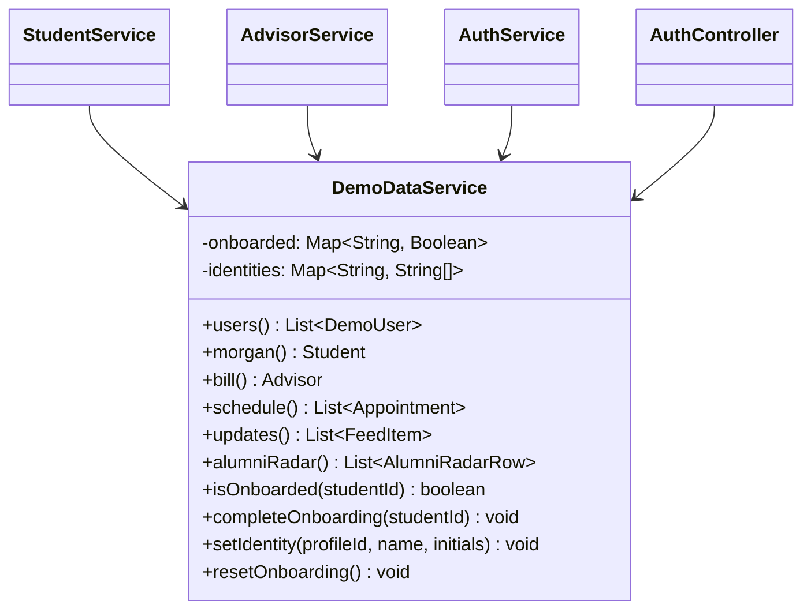
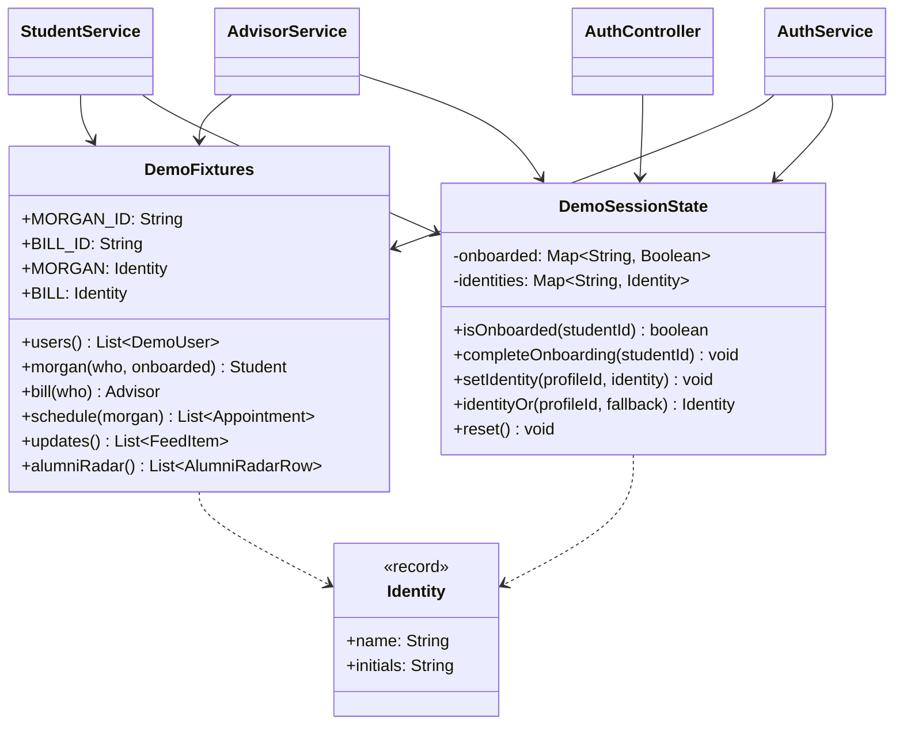

# Refactoring Log

Before/after entries for each refactoring, with the commit that made it.

## 1. Split `DemoDataService` into fixtures and session state

**Principle:** Single Responsibility · **Jira:** SCRUM-59 (SCRUM-61 to SCRUM-64) · **Commit:** [`fec28c0`](https://github.com/WeildTheSword/streetcar/commit/fec28c0)

**Before.** `DemoDataService` held the hardcoded demo fixtures *and* the demo's mutable state (the onboarding flags and the identities that sign-ups wear). Every fixture method read the state maps, so the class had two reasons to change, and all four of its callers depended on both jobs. See [solid-audit.md](solid-audit.md) for why this one was picked.



**After.** `DemoFixtures` is stateless: each method is a pure function of the identity and onboarding flag passed in. `DemoSessionState` owns the two maps. The services read the state, then ask the fixtures for the matching record. `AuthController` only needs the state to reset the demo, so it no longer sees the fixtures at all. The `String[]` identity pair became an `Identity` record.



**Result.** The API responses are unchanged. The fixtures and the state are now tested separately (`DemoFixturesTest`, `DemoSessionStateTest`), and a state test no longer builds the fixture set.

## 2. Move submission validation out of `SubmissionController`

**Principle:** Single Responsibility · **Jira:** SCRUM-68 · **Commit:** [`7bfd8d8`](https://github.com/WeildTheSword/streetcar/commit/7bfd8d8)

**Before.** `SubmissionController` mapped the `/submissions` routes and also decided what a valid submission is. The GPA range, its two-decimal limit and the 2000 / 120 / 200 character limits were private methods on the controller, and the error message repeated the same numbers by hand. The rules had no test of their own: the only way to exercise them was through an HTTP request.

```java
// SubmissionController
private void validate(Submission input) {
    if (input.gpa() == null || input.gpa().compareTo(BigDecimal.ZERO) < 0
            || input.gpa().compareTo(new BigDecimal("4")) > 0
            || input.gpa().stripTrailingZeros().scale() > 2
            || !validText(input.completedCourses(), 2000)
            || !validText(input.major(), 120) || !validText(input.careerGoal(), 200)) {
        throw new IllegalArgumentException();
    }
}
```

**After.** `SubmissionValidator` owns the rules, the limits as named constants, and the message built from those constants. The controller is injected with it and only maps requests and errors.

```java
// SubmissionController
public Submission create(@RequestBody Submission input) {
    validator.validate(input);
    return service.create(input);
}
```

**Result.** `POST` and `PUT /submissions` answer exactly as before, including the 400 message. The rules now have their own unit tests (`SubmissionValidatorTest`, eight cases including the GPA boundaries and trimmed lengths), and a limit lives in one place instead of two.
