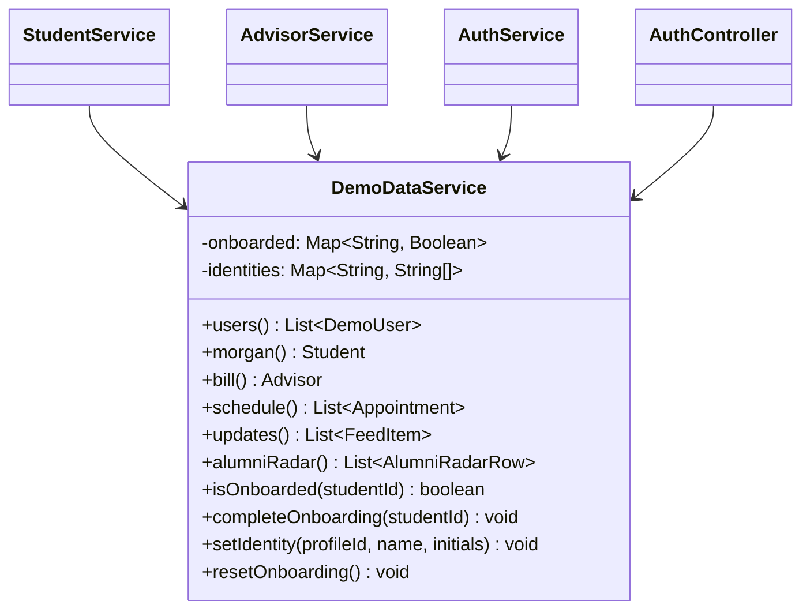
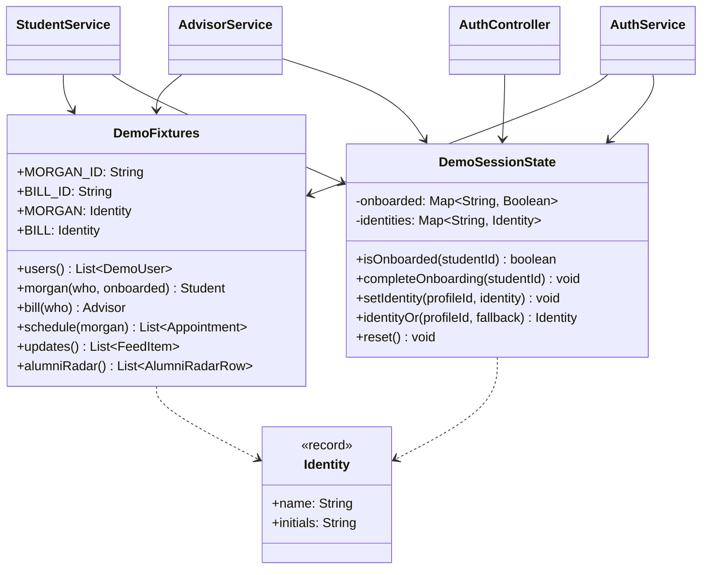

# Refactoring Log

Before/after entries for each refactoring, with the commit that made it.

## 1. Split `DemoDataService` into fixtures and session state

**Principle:** Single Responsibility · **Jira:** SCRUM-59 (SCRUM-61 to SCRUM-64) · **Commit:** [`fec28c0`](https://github.com/WeildTheSword/streetcar/commit/fec28c0)

**Before.** `DemoDataService` held the hardcoded demo fixtures *and* the demo's mutable state (the onboarding flags and the identities that sign-ups wear). Every fixture method read the state maps, so the class had two reasons to change, and all four of its callers depended on both jobs. See [solid-audit.md](solid-audit.md) for why this one was picked.



**After.** `DemoFixtures` is stateless: each method is a pure function of the identity and onboarding flag passed in. `DemoSessionState` owns the two maps. The services read the state, then ask the fixtures for the matching record. `AuthController` only needs the state to reset the demo, so it no longer sees the fixtures at all. The `String[]` identity pair became an `Identity` record.



**Result.** The API responses are unchanged. The fixtures and the state are now tested separately (`DemoFixturesTest`, `DemoSessionStateTest`), and a state test no longer builds the fixture set.

## 4. Extract the shared submission form fields out of `SubmissionsPage`

**Principle:** Single Responsibility · **Jira:** SCRUM-70 · **Commit:** [`215e9b1`](https://github.com/WeildTheSword/streetcar/commit/215e9b1)

**Before.** `SubmissionsPage.jsx` rendered the four submission fields twice, once in the create form and once in the inline edit form. The labels, the 2000 / 120 / 200 `maxLength` limits, the "fill in every field" check and its message were all written out in both places. Changing one field meant editing two copies and keeping them in step by hand.

```jsx
// create form                                   // edit form
<label htmlFor="major">Major</label>             <label htmlFor={`major-${record.id}`}>Major</label>
<input id="major" name="major"                   <input id={`major-${record.id}`} name="major"
  maxLength={120} required />                      maxLength={120} defaultValue={record.major} required />
```

**After.** `components/SubmissionFields.jsx` renders the four fields once and takes an id suffix and default values. The blank-field check, its message, and reading a form into the API shape live in `lib/submissionForm.js`. The page uses both in each form.

```jsx
<SubmissionFields />                                            // create
<SubmissionFields idSuffix={record.id} values={record} />       // edit
```

**Result.** The rendered page is the same, and both existing `SubmissionsPage` test files pass unchanged. `SubmissionFields.test.jsx` adds a render test and an interaction test for the new component. The page drops from 147 to 135 lines, and the field markup now exists in one place.
