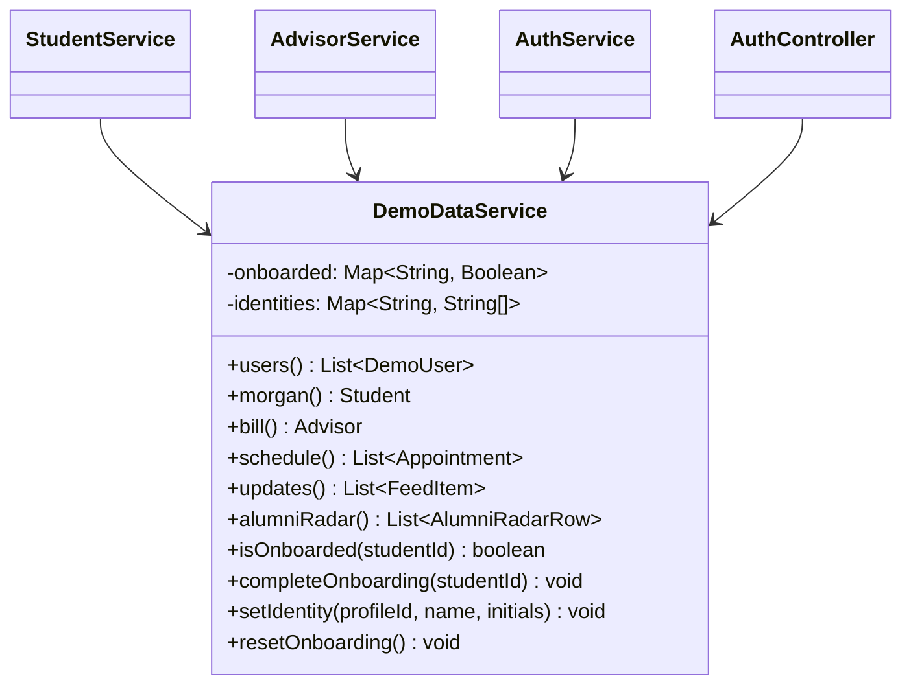
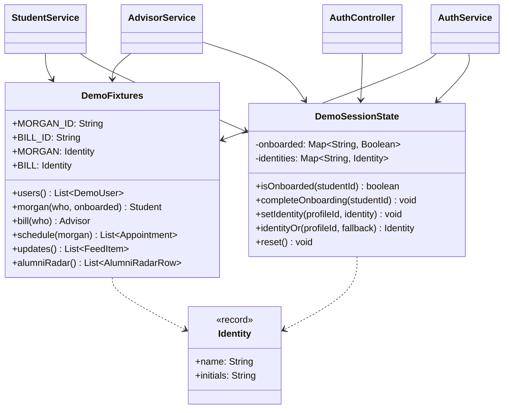

# Refactoring Log

Before/after entries for each refactoring, with the commit that made it.

## 1. Split `DemoDataService` into fixtures and session state

**Principle:** Single Responsibility · **Jira:** SCRUM-59 (SCRUM-61 to SCRUM-64) · **Commit:** [`fec28c0`](https://github.com/WeildTheSword/streetcar/commit/fec28c0)

**Before.** `DemoDataService` held the hardcoded demo fixtures *and* the demo's mutable state (the onboarding flags and the identities that sign-ups wear). Every fixture method read the state maps, so the class had two reasons to change, and all four of its callers depended on both jobs. See [solid-audit.md](solid-audit.md) for why this one was picked.



**After.** `DemoFixtures` is stateless: each method is a pure function of the identity and onboarding flag passed in. `DemoSessionState` owns the two maps. The services read the state, then ask the fixtures for the matching record. `AuthController` only needs the state to reset the demo, so it no longer sees the fixtures at all. The `String[]` identity pair became an `Identity` record.



**Result.** The API responses are unchanged. The fixtures and the state are now tested separately (`DemoFixturesTest`, `DemoSessionStateTest`), and a state test no longer builds the fixture set.

## 2. Move submission validation out of `SubmissionController`

**Principle:** Single Responsibility · **Jira:** SCRUM-68 · **Commit:** [`7bfd8d8`](https://github.com/WeildTheSword/streetcar/commit/7bfd8d8)

**Before.** `SubmissionController` mapped the `/submissions` routes and also decided what a valid submission is. The GPA range, its two-decimal limit and the 2000 / 120 / 200 character limits were private methods on the controller, and the error message repeated the same numbers by hand. The rules had no test of their own: the only way to exercise them was through an HTTP request.

```java
// SubmissionController
private void validate(Submission input) {
    if (input.gpa() == null || input.gpa().compareTo(BigDecimal.ZERO) < 0
            || input.gpa().compareTo(new BigDecimal("4")) > 0
            || input.gpa().stripTrailingZeros().scale() > 2
            || !validText(input.completedCourses(), 2000)
            || !validText(input.major(), 120) || !validText(input.careerGoal(), 200)) {
        throw new IllegalArgumentException();
    }
}
```

**After.** `SubmissionValidator` owns the rules, the limits as named constants, and the message built from those constants. The controller is injected with it and only maps requests and errors.

```java
// SubmissionController
public Submission create(@RequestBody Submission input) {
    validator.validate(input);
    return service.create(input);
}
```

**Result.** `POST` and `PUT /submissions` answer exactly as before, including the 400 message. The rules now have their own unit tests (`SubmissionValidatorTest`, eight cases including the GPA boundaries and trimmed lengths), and a limit lives in one place instead of two.

## 3. Move the demo reset out of `AuthController`

**Principle:** Single Responsibility · **Jira:** SCRUM-69 · **Commit:** [`3c542ed`](https://github.com/WeildTheSword/streetcar/commit/3c542ed)

**Before.** `POST /auth/reset` reset the demo inside the controller. `AuthController` depended on `DemoSessionState` only for this, so an HTTP class had to know every place demo state lives. Any new piece of demo state would have meant editing the controller.

```java
// AuthController
public ResponseEntity<Void> reset() {
    session.reset();
    authService.clearCreatedAccounts();
    return ResponseEntity.noContent().build();
}
```

**After.** `DemoResetService` owns "put the demo back to its opening state". The controller depends on `AuthService` and `DemoResetService` only, and `reset()` makes one call.

```java
// AuthController
public ResponseEntity<Void> reset() {
    demoReset.reset();
    return ResponseEntity.noContent().build();
}
```

**Result.** `/auth/reset` behaves as before: it was checked against the running API by signing up, onboarding, resetting, and confirming the created account is refused and onboarding is cleared. `DemoResetServiceTest` covers the reset directly with four cases, and `AuthController` no longer imports `DemoSessionState`.

## 4. Extract the shared submission form fields out of `SubmissionsPage`

**Principle:** Single Responsibility · **Jira:** SCRUM-70 · **Commit:** [`215e9b1`](https://github.com/WeildTheSword/streetcar/commit/215e9b1)

**Before.** `SubmissionsPage.jsx` rendered the four submission fields twice, once in the create form and once in the inline edit form. The labels, the 2000 / 120 / 200 `maxLength` limits, the "fill in every field" check and its message were all written out in both places. Changing one field meant editing two copies and keeping them in step by hand.

```jsx
// create form                                   // edit form
<label htmlFor="major">Major</label>             <label htmlFor={`major-${record.id}`}>Major</label>
<input id="major" name="major"                   <input id={`major-${record.id}`} name="major"
  maxLength={120} required />                      maxLength={120} defaultValue={record.major} required />
```

**After.** `components/SubmissionFields.jsx` renders the four fields once and takes an id suffix and default values. The blank-field check, its message, and reading a form into the API shape live in `lib/submissionForm.js`. The page uses both in each form.

```jsx
<SubmissionFields />                                            // create
<SubmissionFields idSuffix={record.id} values={record} />       // edit
```

**Result.** The rendered page is the same, and both existing `SubmissionsPage` test files pass unchanged. `SubmissionFields.test.jsx` adds a render test and an interaction test for the new component. The page drops from 147 to 135 lines, and the field markup now exists in one place.

## 7. Replace `LoginPage`'s copy conditionals with lookup tables

**Smell:** Repeated conditional · **Move:** Replace Conditional with a lookup table · **Jira:** SCRUM-75 · **Commit:** [`da766b0`](https://github.com/WeildTheSword/streetcar/commit/da766b0)

**Before.** `LoginPage.jsx` chose its copy by branching on the same two values again and again: `mode === "signup"` picked the eyebrow, heading, lede and switch link, and `role === "ADVISOR"` picked the role label, the "Not a student?" link, the wrong-account error and two transition messages. The strings for one mode or role were scattered across the file, and a third mode or role would have meant finding and editing every branch.

```jsx
<h2>{mode === "signup" ? "Create your account" : "Welcome back"}</h2>
<p>
  {mode === "signup"
    ? "Takes a moment. Streetcar builds the rest from your record."
    : "Use your Tulane credentials to continue."}
</p>
// ...and in the handlers
setError(
  role === "ADVISOR"
    ? "That is a student account. Choose Student, or use advisor credentials."
    : "That is an advisor account. Choose Advisor, or use student credentials.",
);
```

**After.** `MODE_COPY` and `ROLE_COPY` hold every mode- and role-specific string, keyed by mode and by role. The component looks its copy up once and reads from it.

```jsx
const MODE_COPY = {
  signup: { eyebrow: "sign up", heading: "Create your account", lede: "...", switchLabel: "...", switchTo: "signin" },
  signin: { eyebrow: "sign in", heading: "Welcome back", lede: "...", switchLabel: "...", switchTo: "signup" },
};

<h2>{modeCopy.heading}</h2>
<p>{modeCopy.lede}</p>
setError(ROLE_COPY[role].wrongAccount);
```

**Result.** No copy ternary on `mode` or `role` remains. The conditionals that are left choose behavior (which form to show, which route to open), not words. `LoginPage.test.jsx` was written and committed first, against the old code: a render test, a sign-up/sign-in toggle test, and two tests for the role copy (the wrong-account error and the transition message). All four pass unchanged after the refactor, and `npm run lint` and `npm run build` pass with no new warnings.
