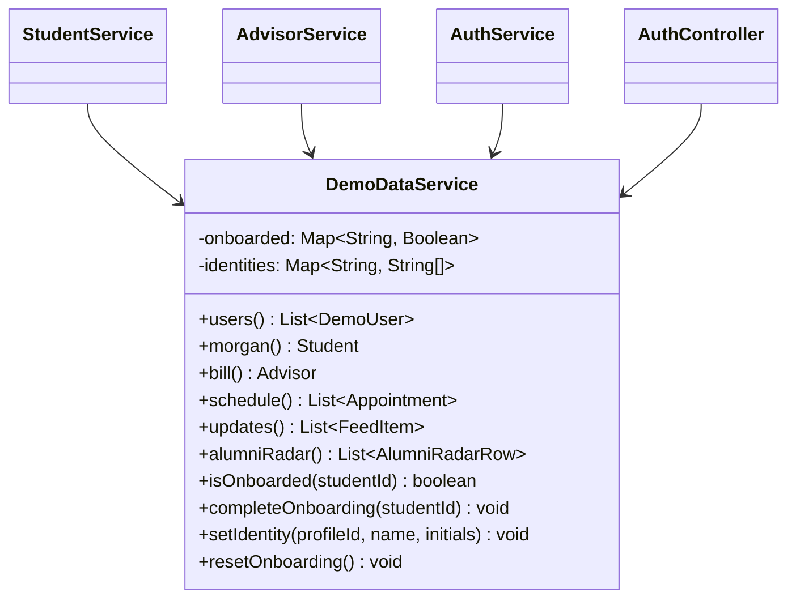
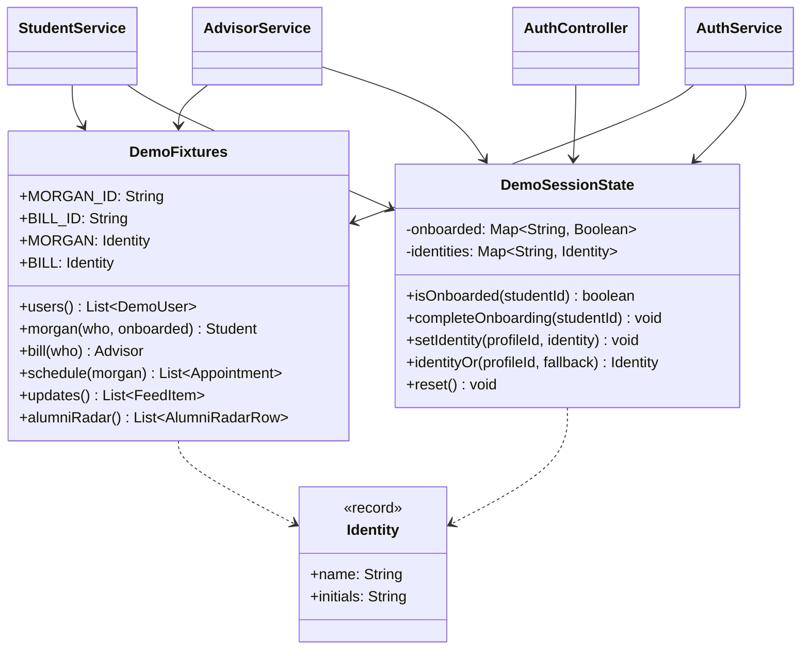

# Refactoring Log

Before/after entries for each refactoring, with the commit that made it.

## 1. Split `DemoDataService` into fixtures and session state

**Principle:** Single Responsibility · **Jira:** SCRUM-59 (SCRUM-61 to SCRUM-64) · **Commit:** [`fec28c0`](https://github.com/WeildTheSword/streetcar/commit/fec28c0)

**Before.** `DemoDataService` held the hardcoded demo fixtures *and* the demo's mutable state (the onboarding flags and the identities that sign-ups wear). Every fixture method read the state maps, so the class had two reasons to change, and all four of its callers depended on both jobs. See [solid-audit.md](solid-audit.md) for why this one was picked.



**After.** `DemoFixtures` is stateless: each method is a pure function of the identity and onboarding flag passed in. `DemoSessionState` owns the two maps. The services read the state, then ask the fixtures for the matching record. `AuthController` only needs the state to reset the demo, so it no longer sees the fixtures at all. The `String[]` identity pair became an `Identity` record.



**Result.** The API responses are unchanged. The fixtures and the state are now tested separately (`DemoFixturesTest`, `DemoSessionStateTest`), and a state test no longer builds the fixture set.

## 2. Move submission validation out of `SubmissionController`

**Principle:** Single Responsibility · **Jira:** SCRUM-68 · **Commit:** [`7bfd8d8`](https://github.com/WeildTheSword/streetcar/commit/7bfd8d8)

**Before.** `SubmissionController` mapped the `/submissions` routes and also decided what a valid submission is. The GPA range, its two-decimal limit and the 2000 / 120 / 200 character limits were private methods on the controller, and the error message repeated the same numbers by hand. The rules had no test of their own: the only way to exercise them was through an HTTP request.

```java
// SubmissionController
private void validate(Submission input) {
    if (input.gpa() == null || input.gpa().compareTo(BigDecimal.ZERO) < 0
            || input.gpa().compareTo(new BigDecimal("4")) > 0
            || input.gpa().stripTrailingZeros().scale() > 2
            || !validText(input.completedCourses(), 2000)
            || !validText(input.major(), 120) || !validText(input.careerGoal(), 200)) {
        throw new IllegalArgumentException();
    }
}
```

**After.** `SubmissionValidator` owns the rules, the limits as named constants, and the message built from those constants. The controller is injected with it and only maps requests and errors.

```java
// SubmissionController
public Submission create(@RequestBody Submission input) {
    validator.validate(input);
    return service.create(input);
}
```

**Result.** `POST` and `PUT /submissions` answer exactly as before, including the 400 message. The rules now have their own unit tests (`SubmissionValidatorTest`, eight cases including the GPA boundaries and trimmed lengths), and a limit lives in one place instead of two.

## 3. Move the demo reset out of `AuthController`

**Principle:** Single Responsibility · **Jira:** SCRUM-69 · **Commit:** [`3c542ed`](https://github.com/WeildTheSword/streetcar/commit/3c542ed)

**Before.** `POST /auth/reset` reset the demo inside the controller. `AuthController` depended on `DemoSessionState` only for this, so an HTTP class had to know every place demo state lives. Any new piece of demo state would have meant editing the controller.

```java
// AuthController
public ResponseEntity<Void> reset() {
    session.reset();
    authService.clearCreatedAccounts();
    return ResponseEntity.noContent().build();
}
```

**After.** `DemoResetService` owns "put the demo back to its opening state". The controller depends on `AuthService` and `DemoResetService` only, and `reset()` makes one call.

```java
// AuthController
public ResponseEntity<Void> reset() {
    demoReset.reset();
    return ResponseEntity.noContent().build();
}
```

**Result.** `/auth/reset` behaves as before: it was checked against the running API by signing up, onboarding, resetting, and confirming the created account is refused and onboarding is cleared. `DemoResetServiceTest` covers the reset directly with four cases, and `AuthController` no longer imports `DemoSessionState`.

## 4. Extract the shared submission form fields out of `SubmissionsPage`

**Principle:** Single Responsibility · **Jira:** SCRUM-70 · **Commit:** [`215e9b1`](https://github.com/WeildTheSword/streetcar/commit/215e9b1)

**Before.** `SubmissionsPage.jsx` rendered the four submission fields twice, once in the create form and once in the inline edit form. The labels, the 2000 / 120 / 200 `maxLength` limits, the "fill in every field" check and its message were all written out in both places. Changing one field meant editing two copies and keeping them in step by hand.

```jsx
// create form                                   // edit form
<label htmlFor="major">Major</label>             <label htmlFor={`major-${record.id}`}>Major</label>
<input id="major" name="major"                   <input id={`major-${record.id}`} name="major"
  maxLength={120} required />                      maxLength={120} defaultValue={record.major} required />
```

**After.** `components/SubmissionFields.jsx` renders the four fields once and takes an id suffix and default values. The blank-field check, its message, and reading a form into the API shape live in `lib/submissionForm.js`. The page uses both in each form.

```jsx
<SubmissionFields />                                            // create
<SubmissionFields idSuffix={record.id} values={record} />       // edit
```

**Result.** The rendered page is the same, and both existing `SubmissionsPage` test files pass unchanged. `SubmissionFields.test.jsx` adds a render test and an interaction test for the new component. The page drops from 147 to 135 lines, and the field markup now exists in one place.

## 8. Split `AdvisorDashboard` into section components

**Smell:** [Large Class](https://refactoring.guru/smells/large-class) (God component), [Long Method](https://refactoring.guru/smells/long-method) · **Move:** Extract Component (Extract Class) · **Jira:** SCRUM-76 · **Commit:** [`c7f08b5`](https://github.com/WeildTheSword/streetcar/commit/c7f08b5)

**Before.** `AdvisorDashboard.jsx` was one 521-line component. It fetched the dashboard, handled the loading and error states, and then rendered every section of the advisor console inline: the heading, the pre-brief hero, four student cards, today's schedule, the updates feed and the alumni radar table. The lookup tables for chip colors and feed icons sat at the top of the file, far from the sections that used them, and none of it had a test.

```jsx
export function AdvisorDashboard() {
  // ...fetch, error and loading states...
  return (
    <AppShell sections={sections} /* ... */>
      {/* Hero pre-brief */}
      <div data-tour="prebrief" /* ...58 lines... */>
      {/* Four cards */}
      <div className="mt-3 grid grid-cols-4 gap-3">
        <Card title={`${firstName} is talking to`} /* ...120 lines for four cards... */>
      {/* Schedule + updates */}
      {/* Alumni radar */}
      <section data-tour="radar" /* ...67 lines... */>
    </AppShell>
  );
}
```

**After.** Each section is its own component under `components/advisor/`, takes its data as props, and keeps its own lookup table (`STATUS_CHIP` in `TalkingToCard`, `TONE_DOT` in `ConcernsCard`, `FEED_ICON` in `UpdatesFeed`). The page loads the data and lays the sections out.

```jsx
<AppShell sections={SECTIONS} /* ... */>
  <AppointmentHeading greetingName={/* ... */} />
  <PreBriefHero nextStudent={nextStudent} nextAppointment={nextAppointment} />
  <div className="mt-3 grid grid-cols-4 gap-3">
    <TalkingToCard firstName={firstName} conversations={nextStudent.conversations} />
    <ConcernsCard firstName={firstName} concerns={nextStudent.concerns} />
    <TopFirmCard /* ... */ />
    <StrategiesCard firstName={firstName} strategies={nextStudent.strategies} />
  </div>
  <div className="mt-7 grid grid-cols-[1fr_360px] gap-7">
    <TodaySchedule schedule={schedule} nextStudentId={nextStudent.id} />
    <UpdatesFeed updates={updates} />
  </div>
  <AlumniRadar alumniRadar={alumniRadar} />
  <DemoGuide key="advisor" steps={ADVISOR_STEPS} intro />
</AppShell>
```

**Result.** The page drops from 521 to 123 lines, and the largest section file is 81 lines. The JSX was moved by line range, not retyped. `AdvisorDashboard.test.jsx` (a render test that also checks the three walkthrough targets, a walkthrough interaction test, and a failed-load test) was committed first, against the unchanged page, and passes unchanged after the split. The rendered DOM for the fixture dashboard was captured before and after and is byte-identical, so the console looks the same. `npm run lint` and `npm run build` pass with no new warnings.
